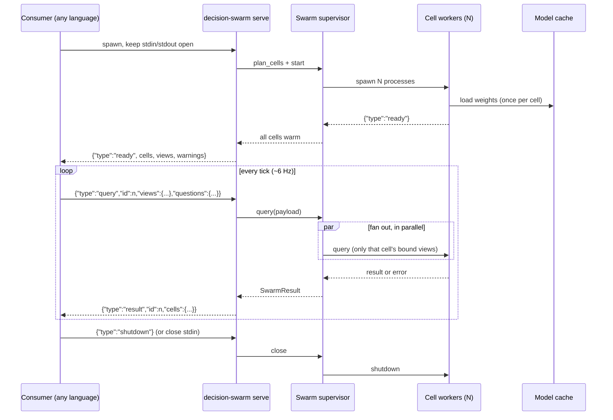
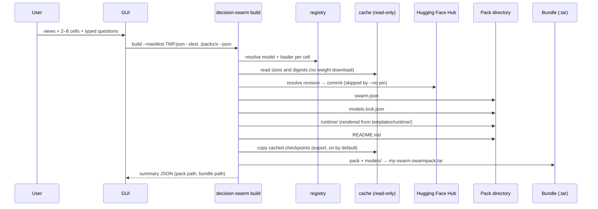
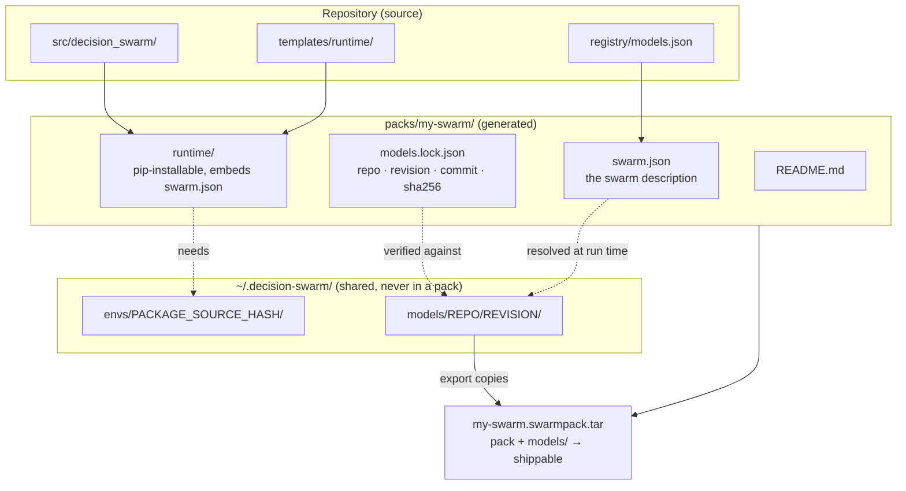
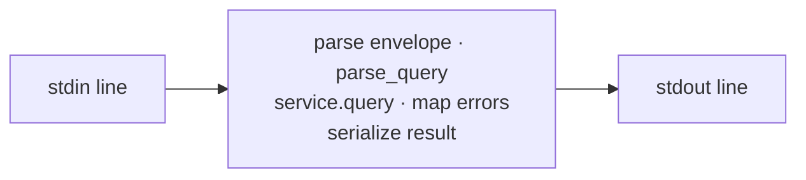
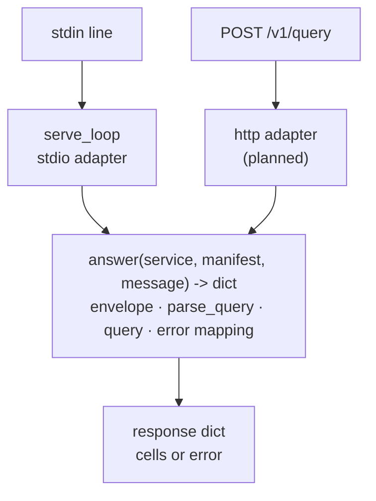
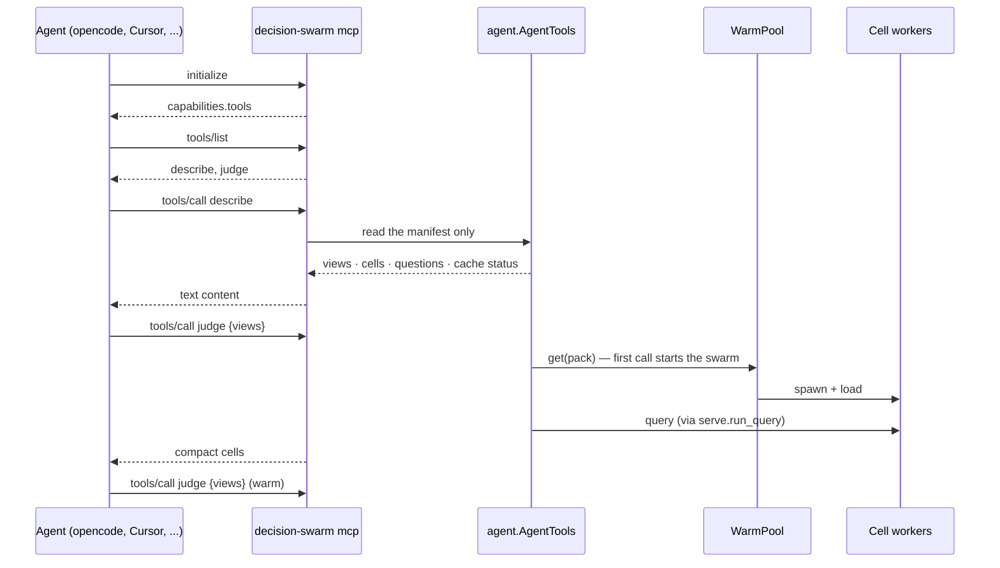

# Architecture

How the pieces fit, where the process boundaries are, and which layer owns which
decision. Companion to [`README.md`](../README.md); design decisions live in
[`adr/`](./adr/). Vocabulary is defined in [`GLOSSARY.md`](../GLOSSARY.md).

## 1. System map

```mermaid
flowchart LR
  HF[("Hugging Face Hub")]

  subgraph buildtime["Build time — authoring + packaging"]
    GUI["Desktop GUI<br/>Tauri v2 shell + vanilla JS"]
    CLI_B["decision-swarm build"]
    PACKDIR["Pack directory<br/>swarm.json · models.lock.json<br/>runtime/ · README.md"]
  end

  subgraph runtime["Run time — Python engine (one process, one supervisor)"]
    CLI_R["decision-swarm serve / run / mcp"]
    PLAN["orchestrator.plan_cells<br/>model · loader · interpreter · view types"]
    SWARM["orchestrator.Swarm<br/>warm supervisor"]
    SRV["serve.serve_loop<br/>JSONL on stdio"]
    MCPW["runtime/mcp.py<br/>MCP tools over stdio"]
    W1["worker · cell A<br/>own venv, own model copy"]
    W2["worker · cell B<br/>own venv, own model copy"]
    W3["worker · cell C<br/>own venv, own model copy"]
  end

  subgraph consumers["Consumers — any language"]
    PY["Python"]
    RS["Rust"]
    ND["Node"]
    GD["Godot / browser"]
    AG["AI agent<br/>opencode · Cursor · Claude Code"]
  end

  CACHE[("Shared caches<br/>~/.decision-swarm/models<br/>~/.decision-swarm/envs")]

  GUI --> CLI_B
  CLI_B --> PACKDIR
  HF --> CACHE
  PACKDIR --> CLI_R
  CLI_R --> PLAN --> SWARM
  CLI_R --> SRV
  SRV <--> SWARM
  MCPW <-->|describe · judge| SWARM
  MCPW -.->|authoring tools (optional)| PACKDIR
  AG <-->|MCP tools| MCPW
  SWARM <--> W1
  SWARM <--> W2
  SWARM <--> W3
  CACHE --> W1
  CACHE --> W2
  CACHE --> W3
  PY <--> SRV
  RS <--> SRV
  ND <--> SRV
  PY -.->|"in-process (library)"| SWARM
  GD -.->|"planned: --http"| CLI_R
```

The load-bearing line is **`SWARM <--> W1..W3`**: the swarm is a set of child
*processes*, not threads or in-process objects. That is what makes env isolation
and per-cell model copies possible, and it is why any consumer only ever needs to
talk to the supervisor.

## 2. `serve` — the long-lived path



`run` is the same topology with a session of exactly one query: spawn workers,
wait for warm, one `query`, tear down. Nothing else differs.

## 3. `build` — how a pack is made



A build fetches no weights from the Hub — it copies whatever is already in the
cache — but it is not purely offline and not always small: it asks the Hub which
commit each floating revision points at (one metadata call per checkpoint;
`--no-pin` skips it, and a failed lookup just records `commit: null`), and by
default it copies the cached checkpoints into the bundle. The lockfile is what
makes a run verifiable — repo, revision, commit and per-file digests — and a
checkpoint missing from the cache is recorded as `cached: false` rather than
given invented digests. Missing checkpoints also mean no bundle, since the tar
has real weights to copy and cannot invent them.

## 4. Artifacts on disk



**The pack is a description, not a payload.** Weights and envs live outside it,
shared by every pack on the machine. `export` produces the one artifact that *does*
carry weights — a bundle — and unpacking it puts a `models/` directory beside the pack,
which `serve`/`run` pick up automatically.

### Handing a swarm to someone else

1. **Sender** (GUI or CLI): *Download* to populate the cache, `install` to build the
   cell envs, then *Submit*, which writes `my-swarm/` **and**
   `my-swarm.swarmpack.tar` containing `my-swarm/`, `models/<repo>/<revision>/` and
   `envs/<package-source-key>/`. Ship the `.tar`.
2. **Recipient**: unpack it, then `decision-swarm serve --pack my-swarm`. No GUI, no
   shared cache, no PyPI round trip, no Hub access.

Env bundling is best-effort by design. `build` warns when an env was never built — the
bundle then carries weights only and the recipient runs `install` themselves
(`--no-envs` asks for that explicitly). And a venv retains a pointer to the base
interpreter it was created from, so a bundled env only works when the recipient has that
same interpreter path; otherwise `plan_cells` falls back to the current interpreter with
a warning and the recipient should `install`.

## 5. Who owns what

Four words that are easy to conflate; each answers a different question.

| Layer | Question it answers | Where it lives | Chosen when | Language |
|---|---|---|---|---|
| **Engine** | "What computes the answers?" | `src/decision_swarm/` | never — it *is* the program | Python only |
| **Pack** | "Which cells, views, questions, and which models?" | `packs/<name>/` | Submit | data |
| **Bundle** | "How does it travel?" | `<pack>.swarmpack.tar` | Submit (`--export`, on by default) | data |
| **Transport** | "How does a consumer reach a warm swarm?" | `serve` (JSONL on stdio) or `mcp` (MCP tools on stdio) | at start | n/a |
| **Runtime** | "How does a *Python* consumer get a command/import?" | pack's `runtime/` | always generated today | Python |
| **Client** | "How does *my* code call it?" | the consumer's repo | by the consumer | any |

Two consequences worth stating plainly:

- A Submit dropdown cannot pick a language. The pack does not know who will drive
  it, and the same directory serves every consumer.
- `runtime/` is a convenience, not a requirement. `decision-swarm serve --pack
  ./my-swarm` works without it.

## 6. The `answer()` seam

`serve.run_query()` and `serve.answer()` hold everything protocol-independent:
envelope checks, `parse_query`, `service.query`, and error → dict. Two adapters sit
thinly on top of it today — the JSONL stdio loop and the MCP tool server — and a
future HTTP transport is a third adapter rather than a rewrite.

**Before ADR-0002 — logic inline in the stdio adapter:**



**After the seam — logic once, adapters trivial:**



What each side owns:

| Piece | Responsibility |
|---|---|
| `answer()` | everything protocol-independent: envelope checks, `parse_query`, `service.query`, error → dict |
| `run_query()` | the same path, returning the `SwarmResult` so a caller can project it |
| `serve_loop()` | read a line, call `answer()`, write a line, honour `shutdown` / EOF |
| MCP adapter (`runtime/mcp.py`) | JSON-RPC in, `tools/call` → tool handler → text content out; emits no `ready` line because a tool call is its own request |
| HTTP adapter (planned) | body in, status + body out, `GET /v1/health` from the same `ready` payload |

HTTP stays a flag on the existing command (`serve --pack P --http`), not a new
command, so the warm-up sequence and the process lifecycle are identical. Under
`--http` the `ready` line carries `"url"`, so a consumer that spawned the process
can discover the bound port (`--port 0` binds an ephemeral one), and
`GET /v1/health` returns the same payload.

Requests are serialized: one swarm per process, queued behind a lock, each query
still fanning out to all cells in parallel. A second concurrent consumer is a
second process, not a worker pool.

## 7. `mcp` — how an agent uses a pack

A program drives a pack through `serve`. An agent cannot: it has no pipe to keep and
no place to hold a wire format. `mcp` gives it the pack as two tools, backed by the
same warm swarm.



The two calls are split by cost, and that split is the whole shape of agent use:

| Tool | Cost | Returns |
|---|---|---|
| `describe` | a manifest read — no model load | views, cells, each cell's questions and criteria, cache status |
| `judge` | model load on the first call for a pack, then model latency | per-cell answers with confidence |

`describe` first is the intended flow: it is free, so an agent discovers which views
to supply before any weights move. `judge` then stays warm for the rest of the
session. With no `pack` argument, `describe` lists the packs it can see — that is how
an agent finds out what exists.

| Piece | Owns |
|---|---|
| `runtime/mcp.py` | JSON-RPC framing, the four methods, `isError` mapping, stdout purity |
| `agent.AgentTools` | the tool table, pack resolution, projections |
| `agent.WarmPool` | lazy start, LRU eviction at `--max-warm`, shutdown |
| `serve.run_query()` | envelope + `parse_query` + `service.query`, shared with `serve_loop` |

Two properties worth stating plainly:

- **One warm swarm at a time.** A swarm is gigabytes of weights across 2–8 worker
  processes, so judging a second pack evicts the first (`--max-warm` to change).
- **stdout is the transport.** `serve()` hands file descriptor 1 to stderr for the
  session, so a stray `print`, a `pip` run or a download progress bar cannot corrupt
  the stream.

Agents *can* also build and prepare packs — `list_models`, `build`, `fetch`, `install`,
`export` — but that is an operator convenience, not the intended path: the GUI and CLI
author packs, agents consume them. When those tools are reachable they are gated, because
a manifest is model-authored data and `envs.build_env` executes a cell's
`package_source` with pip: model ids and package sources must resolve in
`registry/models.json` unless the server runs with `--allow-unvetted`.

## 8. What is deliberately not here

- **No in-process inference outside Python.** Weights are PyTorch checkpoints and
  the only loaders are `laya` / `laya-vision`. No ONNX export exists, so Rust and
  Godot consume the engine as a *process*, not a library.
- **No HTTP transport yet.** `serve` speaks stdio; browsers and Godot web exports
  need the seam above.
- **No aggregation or consensus.** v1 returns raw per-cell answers; the worker
  topology is shaped so neighbour links can be added later.
