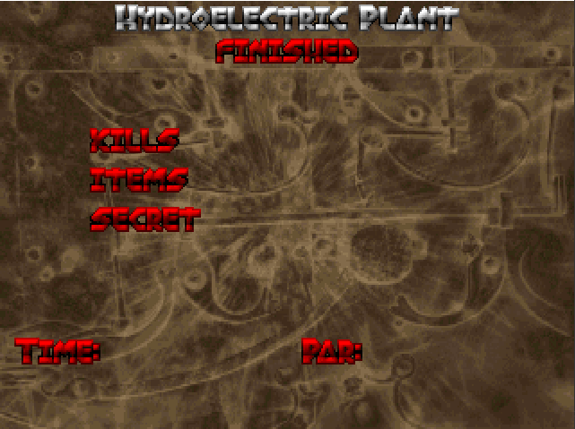

# Example: a swarm that plays Doom

Two people do this. **You** build the swarm pack by hand in the desktop GUI — that is
Part 1, and it is the only part a human has to do. **An agent** then writes a Python
program that drives the pack, plays the game, and records what the swarm decided —
that is Part 2.

The end result is a video of Doom played by two cells with **different roles**: one
**sees** the screen and proposes the button, the other **reads** the game state as text
whose `scene` view is the evidence the veto is built from. Plus a log of every decision,
including the ones where the veto overrode the proposal.

That split is the finding, not a detail. The first version of this example asked both
cells the **same** question and pooled their votes. It does not work: the text cell
answered the action question at roughly chance and the fitted weight of its vote was
zero. Two cells answering one question are one opinion with extra latency. Give cells
different roles instead — the measurements are in
[Findings](#findings-what-the-measurements-said).

Why `laya-vision` for the seeing cell: it is trained to answer typed questions about a
picture, and its published game scores come from the same ViZDoom "basic" scenario used
here (`ViZDoom basic: 0.99`, where 0 is random play and 1 is the scripted expert). The
screen is the image, the buttons are the options — it is the one model here that has
actually seen this game.

---

## Part 1 — Build the pack in the GUI (a person does this)

### 0. Install the GUI

Download the Windows portable `.zip` from this repo's GitHub Releases page, unzip it
anywhere, and run the app. It bundles the engine, so building a swarm needs no Python
and no git checkout. Models download on first use into `%USERPROFILE%\.decision-swarm\models`.

### 1. Swarm panel — name and size

| Field | Value |
|---|---|
| Pack name | `doom-swarm` |
| Cells | `2` |

Two cells, not eight. Each cell is a separate worker process holding its own copy of
the model in VRAM, so on an 8 GB card two is the sane ceiling for a demo.

### 2. Swarm panel — the observation views

Add **three** views. The name must be a slug (`a-z0-9_-`) and the type must match what
the player will send.

| View name | Type | What the player puts in it |
|---|---|---|
| `screen_now` | `image` | absolute path to a PNG of the current frame |
| `hud` | `text` | what the game reports: `tic=148/300 ammo2=26 health=100 kills=1 attack_ready=1` |
| `scene` | `text` | what the driver measures: `Zombie bearing=-8 distance=410 width=0.18` |

Define all three **before** binding them to cells: the cell view checkboxes are
generated from this list, and renaming a view afterwards silently unchecks it.

Why three views and two different models: diversity in this repo is structural — a cell
answers only about the views it is bound to, using its own model. Two `laya-vision` cells
reading the same picture with the same question return the same answer and waste a model
copy. One cell that **sees** the frame and one that **reads** two text reports work from
evidence neither can supply for the other, which is what makes a second role possible.

The two text views are deliberately split by **who authored them**. `hud` is a straight
dump of variables the engine exposes; `scene` is geometry the driver computes — where the
monster is, in degrees and map units. Keep them apart because it is how you will debug a
bad decision later: a wrong `hud` means the variables were misread, a wrong `scene` means
the bearing maths is wrong. Both are joined into the text model's single text context,
`hud` first.

### 3. Cells panel — cell 1

| Field | Value |
|---|---|
| Cell id | `lookout` |
| Model | `laya-vision` |
| Views | check `screen_now` **only** |

`laya-vision` weights are **CC BY-NC-SA 4.0** (non-commercial); the card shows this. Fine
for a personal demo.

Keep this cell pixels-only. The loader does accept text alongside an image — it folds
text views into the model's `note` field, and the model card's own example uses one — but
the point of this pack is that the two cells work from different evidence. Handing the
HUD to both makes them agree for the same reasons.

Do **not** tick two image views here either. The loader uses one image per state and
warns `multiple image views bound` while dropping the rest, so a second frame in this
cell is silently ignored. Two frames at once would need a loader change.

### 4. Cells panel — cell 1's question

Questions are per cell, and the two cells get **different** questions because they have
different jobs. `lookout` — the cell that can see — proposes the button here. `analyst`
gets a yes/no question about the shot in step 6 instead of a second vote on the same
question.

| Field | Value |
|---|---|
| Question name | `next_action` |
| Type | `choice` |
| Instructions | `You are looking at the current Doom screen of the ViZDoom basic scenario: a room with a monster ahead and a health pack to the side. Choose the single button to hold for the next six tics.` |

Options — three of them, keys typed exactly as below (the player will match on these
strings, case-sensitive; keys are not restricted to slugs, but keep them stable):

| Key | Description |
|---|---|
| `ATTACK` | `Fire the weapon now. Only useful when the monster is centred and in front of you.` |
| `MOVE_LEFT` | `Turn left to bring the monster into the centre of the screen.` |
| `MOVE_RIGHT` | `Turn right to bring the monster into the centre of the screen.` |

### 5. Cells panel — cell 2

| Field | Value |
|---|---|
| Cell id | `analyst` |
| Model | `laya-typed-decisions` |
| Views | check `hud` and `scene` **only** |

This is a **text** model (PyPI `laya`, loader `load`), not the vision fork. A
`laya-vision` cell with no image view is not merely a bad idea — it raises
`no image view is bound to this cell` and returns an error on every query. Text
observations need a text model.

`laya-typed-decisions` is the right text checkpoint here: the registry describes it as
fine-tuned for typed decisions over structured state, including agent-trace observability,
which is what a HUD line is. It runs in its own env because its package source
(`laya>=0.3.20`) differs from the vision fork's git install — the reason this repo keeps
one venv per package source.

### 6. Cells panel — cell 2's question

| Field | Value |
|---|---|
| Question name | `hit_now` |
| Type | `noul` |
| Instructions | `You cannot see the screen; you are given the player's state as text. hud reports the in-game clock (tic out of 300), ammo, health, kills and whether the weapon can fire. scene reports each visible object by name, with bearing in degrees from the centre of the view (negative is left, positive is right), distance in map units, and how wide it appears as a fraction of the screen. If the player fires in the next six tics, will the shot hit the monster?` |

No options — `noul` returns a yes/no probability. The name and type differ from
`lookout`'s on purpose: the cells have different roles, so they are not asked the same
question. Do **not** add a second `next_action` choice question here and pool the two
votes; that was the first version of this example and it is the wrong use of a pack. The
text cell answered that question at 45.3% on the validation split (79% for the vision
cell) and the fitted weight of its vote was zero — pooling changed nothing. The pattern
that works is **role arbitration**: one cell proposes, a role checks, and the driver
decides which role owns the decision.

`hit_now` is a role question, not a vote. Be aware that it was the weak half of this
demo: its probability barely moved with the scene, so the driver logs it and lets the
engineered geometry own the veto. That negative result is worth reproducing once — see
[Findings](#findings-what-the-measurements-said).

Spell out the field conventions in the instructions, as above, because the model cannot
guess them: it does not know that negative means left, or that distance is in map units.
Explain the units, and stop there — hand it thresholds ("attack under 10 degrees") and the
demo becomes your rule engine wearing a model's confidence scores.

### 7. What the Cluster panel should show

Before submitting, the cluster panel is a free sanity check. It reports filled cells,
unique checkpoints, total parameter count, estimated disk, and estimated RAM. For this
pack expect **2 unique checkpoints** — `thaitea/laya-vision` (201M) and
`convaiinnovations/laya` at `typed-decisions/` (421M) — about **620M parameters** and
roughly **1.65 GB** on disk. If it reports 1 checkpoint, both cells are on the same model
and the pack has lost its second role.

The bottom validation bar must read `Configuration valid — 2 cells · 3 views · 2 questions`.
If it names a problem, fix it there — an invalid configuration never reaches the engine.

### 8. Cluster panel — download and submit

1. **Download models.** Two checkpoints, ~1.6 GB total. Wait for `Download complete.` in the
   log. This fills the machine-wide cache at `%USERPROFILE%\.decision-swarm\models`. It is not
   optional even with the bundle unticked: the cache is where the weights live, and a bundle
   cannot be written until they are already there.
2. **Pack output directory.** Replace the default `./packs/my-swarm` with an **absolute**
   path, e.g. `C:\doom\packs\doom-swarm`. The default is relative to the app's working
   directory, which is not where you want to hunt for it later.
3. **Bundle checkbox.** It is **checked by default**, and that is what "carry the model"
   means in practice: Submit writes the pack directory *and* `doom-swarm.swarmpack.tar` beside
   it, holding `models/<repo>/<revision>/` plus the built `envs/`. For this example **untick
   it**: you are playing on the machine that already holds the weights in its cache, so the tar
   is a several-gigabyte duplicate. Tick it only when you intend to hand the swarm to another
   machine.
4. **Submit pack.** The log prints `Built C:\doom\packs\doom-swarm — cells: lookout, analyst`.

### 9. Verify the pack on disk

The directory should contain:

```text
C:\doom\packs\doom-swarm\
├── swarm.json          # the manifest: 3 views, 2 cells, 1 question each
├── models.lock.json    # repo, revision, commit, sha256, cached: true, bytes
├── mcp.json            # ready-to-paste agent config with absolute paths
├── README.md
└── runtime\            # generated Python package: <pack-slug> inspect | run | serve
```

The pack directory itself holds no weights: `models.lock.json` pins the repo, revision,
commit and digest, and the weights resolve from the shared cache at
`%USERPROFILE%\.decision-swarm\models`.

Packaging weights is still the default — Submit also writes `doom-swarm.swarmpack.tar`
beside the directory unless you unticked the box, and that tar carries `models/` and
`envs/` inside it. Unpacked, those sit *inside* the pack directory and `serve`/`run` use
them automatically: no shared cache, no PyPI round trip, no extra flag. So "the pack ships
its model" is true of the bundle, not of the directory — the directory is always the small
contract, the bundle is the distributable.

Part 1 is done when `swarm.json` names `screen_now`, `hud` and `scene` under
`input_schema.views`, `lookout` binds only the image view and carries the `next_action`
choice question with the three button keys, and `analyst` binds both text views and
carries the `hit_now` noul question.

---

## Part 2 — An agent writes the player

Hand this to the agent, together with the absolute pack path.

> Build a Python program that plays ViZDoom's `basic` scenario using the swarm pack at
> `C:\doom\packs\doom-swarm`. Use `pip install vizdoom pillow imageio`, get decisions
> from the pack, and write both an MP4 of the episode and one JSONL line per decision.

### What the agent must know before it writes code

**1. The pack is not an API you import — it is a process you talk to.** Start it once and
keep it alive; the models load once and stay warm:

```bat
decision-swarm serve --pack C:\doom\packs\doom-swarm
```

Reads one JSON object per line on stdin, writes one per line on stdout. First line out is
`{"type":"ready", ...}` — wait for it before sending anything. Then each decision is:

```jsonl
-> {"type": "query", "id": 1, "views": {"screen_now": "C:\\doom\\frames\\f0012.png", "hud": "tic=148/300 ammo2=26 health=100 kills=1 attack_ready=1", "scene": "Zombie bearing=-8 distance=410 width=0.18"}}
<- {"type": "result", "id": 1, "cells": {"lookout": {...}, "analyst": {...}}}
```

End with `{"type": "shutdown"}`.

**2. Every query must carry every view bound by any cell.** The manifest binds
`screen_now`, `hud` and `scene`, and validation rejects a query that omits any of them —
even though `lookout` reads only the frame. A driver that sends only the views one cell
needs will get an `error` line, not a result.

**3. Image views are file paths, not base64.** Write the frame to disk, pass the path.
Reuse two alternating filenames rather than accumulating thousands of PNGs.

One image per cell is a hard limit of the loader: bind two image views and it warns
`multiple image views bound` and uses only the first. Do not try to give `lookout` the
current and previous frame — the second is dropped without failing the query.

**4. Never invoke `decision-swarm run` inside the loop.** It spawns workers and loads the
weights on every call: seconds of setup per 100 ms of inference. `serve` exists precisely
to avoid that.

**5. On Windows, check CUDA before timing anything.** `decision-swarm install` installs
only each cell's declared package source, which resolves `torch` to a CPU wheel and skips
`torchvision`. This pack has **two** package sources — the vision fork and PyPI `laya` — so
`install` builds **two** envs and prints a `[key]` for each:

```bat
decision-swarm install --pack C:\doom\packs\doom-swarm
:: built  git+https://github.com/r33drichards/laya-vision  [git-https-...a1b2c3d4]  cells: lookout
:: built  laya>=0.3.20                                     [laya-0-3-20-9f8e7d6c]  cells: analyst
```

Both need the same fix, so loop over every env:

```bat
for /D %E in ("%USERPROFILE%\.decision-swarm\envs\*") do (
  "%E\Scripts\python.exe" -m pip install --force-reinstall torch torchvision --index-url https://download.pytorch.org/whl/cu124
  "%E\Scripts\python.exe" -c "import torch; print('%E', torch.cuda.is_available())"
)
```

Inside a `.bat` file write `%%E` instead of `%E`. If any line prints `False`, stop — the
run will take seconds per frame instead of ~100 ms.

If you shipped the pack as a bundle instead, the envs already came inside it and there is
nothing to install — they sit at `C:\doom\packs\doom-swarm\envs\<key>\` and `serve` finds
them without a flag. Apply the same torch reinstall there.

**6. Doom's clock and the swarm's clock are different.** Doom ticks 35 times a second;
the swarm cannot. Decide once every **6 tics** (~6 decisions/sec) and hold the chosen
button for those 6 tics. Add a `--slowmo` switch that decides once every 35 tics so the
episode is watchable and filmable.

**7. One action per decision — and the aggregation is yours.** The result contains one
answer per cell; nothing in the engine combines them. Do not pool two answers to the same
question. Use **role arbitration**: `lookout` proposes the button, and the `scene` text
(measured by the driver, not by a model) is the authority on whether that button is safe.
Concretely:

- `ATTACK` is allowed only when the closest monster is inside ~5° of centre **and**
  `attack_ready=1`; otherwise the scene supplies `MOVE_LEFT`/`MOVE_RIGHT` toward the
  monster, and that direction wins when vision proposes a strafe the other way.
- Centred but not ready: hold `ATTACK` rather than strafing away from the target.
- Log both cells' answers and the override reason on every decision. The analyst's
  `hit_now` is logged, not used to gate the shot.

Start the centre gate at **5°**, not 2.5°. A paired 18-seed A/B measured the hit envelope
at about ±5.5°; a 2.5° veto rejects shots that hit and is no better than vision alone,
while 5.0° matches vision on almost every seed and still vetoes wild off-centre shots.

**8. `describe` before `judge` if the agent is driving through MCP instead of `serve`.**
`decision-swarm mcp --pack C:\doom\packs\doom-swarm` exposes the pack as two tools:
`describe` returns views, cells, questions and criteria without loading a model, and
`judge` runs one observation. MCP is for an agent making a few calls per task; a
tight game loop wants `serve`.

### Building the two text views

`screen_now` is one line. The text views are the actual work of the driver, and `analyst`
is only as good as they are.

`basic.cfg` exposes **one** game variable — ammo — and a 300-tic timeout. Everything else
has to be requested before `init()`, or it is not in `state.game_variables` at all:

```python
import os
import vizdoom as vzd
from vizdoom import GameVariable as GV

game = vzd.DoomGame()
game.load_config(os.path.join(vzd.scenarios_path, "basic.cfg"))
for name in ("AMMO2", "HEALTH", "KILLCOUNT", "ATTACK_READY",
             "POSITION_X", "POSITION_Y", "ANGLE"):
    game.add_available_game_variable(getattr(GV, name))

game.set_labels_buffer_enabled(True)   # state.labels: names, categories, world positions
game.set_objects_info_enabled(True)    # fills each label's object_position_* fields
game.init()
```

`hud` is a dump of the variables plus the in-game clock:

```python
def hud_line(game, state):
    g = game.get_game_variable
    return (f"tic={state.tic}/300 ammo2={int(g(GV.AMMO2))} "
            f"health={int(g(GV.HEALTH))} kills={int(g(GV.KILLCOUNT))} "
            f"attack_ready={int(g(GV.ATTACK_READY))}")
```

`scene` is measured, not reported. Each label carries a screen bounding box and world
coordinates; convert both into the two things a text model can act on — bearing and
range:

```python
import math

def scene_line(game, state, width):
    g = game.get_game_variable
    px, py = float(g(GV.POSITION_X)), float(g(GV.POSITION_Y))
    parts = []
    for label in state.labels or ():
        if label.object_category == "Player":
            continue
        cx = label.x + label.width / 2
        frac = 2.0 * cx / width - 1.0                  # -1 left edge, +1 right edge
        bearing = math.degrees(math.atan(frac * math.tan(math.radians(45.0))))
        piece = f"{label.object_name} bearing={bearing:.0f} width={label.width / width:.2f}"
        distance = math.hypot(label.object_position_x - px, label.object_position_y - py)
        if distance > 0:
            piece += f" distance={distance:.0f}"
        parts.append(piece)
    return " | ".join(parts) or "no objects visible"
```

Five things that will bite if the driver skips them:

- **`add_available_game_variable` really is required.** `basic.cfg` ships ammo only. Ask
  for `HEALTH` without that call and the value is simply not there — depending on the
  accessor you get an error or a missing entry, never a sensible number.
- **Everything is configured before `init()`.** Game variables, `set_labels_buffer_enabled`
  and `set_objects_info_enabled` are all read at startup. Setting them after `init()`
  does nothing, and `state.labels` stays `None` — silently.
- **Positions and angle are zero when the scenario disables cheats** (`viz_nocheat 1`).
  Detect that once at startup and omit `distance` rather than reporting `distance=0`,
  which reads as "the monster is inside you". Bearing and `width` come from the screen
  box and survive either way.
- **The bearing is an approximation**: screen x is linear, view angle is not, so the
  code above inverts the projection with `atan` under the default 90° FOV. Change the FOV
  or the resolution and the degree figures drift.
- **Label order is not guaranteed.** If you need stable text (you do, for diffing two
  runs), sort `state.labels` by `object_name` before formatting.

One honest note for the write-up: `scene` is engineered, not learned. `analyst`'s
competence comes from this geometry, so the demo shows a trained cell and a hand-built
sensor in different roles — the model proposes, the sensor checks. Do not describe it as
the model "seeing" through text, and do not credit the text cell with the veto: the
geometry did that arithmetic, not the model.

### Acceptance

- `ready` arrives once; no model reload between decisions.
- Wall-clock per decision is measured and logged, and matches a GPU run (< ~200 ms).
- The episode MP4 is playable and the score (`KILLCOUNT`) is nonzero.
- The JSONL has one line per decision: frame paths, both cells' answers (choice or
  noul) with confidences, chosen action, the role that decided it, per-decision latency,
  monotonic decision index.
- `scene` is spot-checked against the frame on a dozen decisions: a monster on the left of
  the screen must never report a positive bearing.

---

## Findings: what the measurements said

Three experiments in a row, each one forced by the previous one's failure. Rows are the
ViZDoom `basic` scenario unless they say `defend_the_center`; "decisions" is the number of
swarm calls until the kill, so lower is better.

### 1. Pooling two votes on one question buys nothing

First version: both cells were asked the same three-action question, with temperatures and
an opinion-pool weight fitted on 967 decisions from 40 episodes.

| policy | validation accuracy | train accuracy | note |
|---|---:|---:|---|
| vision only | 78.8% | 84.6% | ECE 0.046 — already well calibrated |
| text cell only | 45.3% | 45.8% | ECE 0.059; near-uniform, not complementary |
| calibrated opinion pool | 78.8% | 84.6% | **fitted text weight 0.00** |
| bearing gate | 76.1% | 80.4% | 15° threshold; does not generalise |
| role arbitration | **99.7%** | 100.0% | geometry veto + direction |

**The fitted weight of the second cell's vote was zero.** Two cells answering one question
are one opinion with extra latency. Temperatures fitted to 0.85 (vision) and 1.80 (text),
but neither improved validation NLL *and* ECE together, so the applied calibration is
identity. The 99.7% row is also misleading — it measures agreement with a scripted 2.5°
teacher, not play. The next section is why that matters.

### 2. Untrained role arbitration was not better than vision

Here vision proposes the button and the driver's measured geometry vetoes it. 18 paired
seeds, same engine, same model, only the aggregation rule changed:

| policy | decisions | kills | decisions/kill | off-centre ATTACKs | timeouts |
|---|---:|---:|---:|---:|---:|
| vision only | **61** | 18 | **3.39** | 5 | 0 |
| role, 2.5° gate | 70 | 18 | 3.89 | 0 | 0 |
| role, 5.0° gate | **59** | 18 | **3.28** | 4 | 0 |

Paired per seed: role at 2.5° was worse than vision on 4 seeds, better on 1, equal on 13.
Role at 5.0° was better on 1, equal on 17, **worse on 0**. A controlled synchronous probe
put the hit envelope at ±5.5° (157/160 hits; all three misses at 5.9°), so **the 2.5° veto
was turning away from shots that hit**. The veto has real value — it removed wild
off-centre shots — but at the wrong width it costs as much as it saves. It also costs
nothing at inference time: the extra work is arithmetic on the driver's own sensor, not
another model call. **5.0° is the width to copy.**

The other untrained variant was worse still: vision fires, the text cell steers.

| policy | decisions | kills | decisions/kill | text steered | agreed with vision |
|---|---:|---:|---:|---:|---:|
| vision only | 61 | 18 | 3.39 | — | — |
| vision fires + text steers | 111 | 18 | 6.17 | 31/111 | 13 (42%) |

Disagreement caused turn oscillation: seed 11 went from 4 to 23 decisions, seed 8 from 3 to
13. At 45.3% three-action accuracy the text cell is **not a usable steering sensor**.

**Net: untrained role arbitration was not better than vision alone.** The geometry veto
removed bad shots, the text cell's steering added worse ones, and the two cancelled at best.
Any remaining gain had to come from training a cell for the role it was being given.

### 3. A LoRA adapter on the text cell matched vision on one enemy

The fix was to change the question, not the policy: a LoRA adapter on the existing text
checkpoint answering only `MOVE_LEFT` / `MOVE_RIGHT`, so the cell can never vote on firing
and only ever says which way to turn. Firing stays with vision.

| held-out slice | adapter | base |
|---|---:|---:|
| multi-enemy steering (450) | **86.9%** | 48.9% |
| single-enemy steering (114) | **100.0%** | 59.7% |
| guard (30) | **100.0%** | 50.0% |

In the game, with the same 18 seeds:

| policy | decisions | kills | decisions/kill | steering correct |
|---|---:|---:|---:|---:|
| vision only | 61 | 18 | 3.39 | — |
| hybrid, base text | 111 | 18 | 6.17 | 13/31 (42%) |
| hybrid, adapter | **61** | **18** | **3.39** | **41/41 (100%)** |

**The adapter brought the hybrid to exactly vision-only on all 18 seeds — equal on 18,
better on 0, worse on 0.** That is the first evidence that a trained second cell can carry
a real role instead of being dead weight.

### 4. On multiple monsters the swarm steered better and played worse

The single-enemy result did not transfer. First multi-monster test on `defend_the_center`
(10 seeds) with the same v1 adapter:

| policy | kills | deaths | multi-enemy steering |
|---|---:|---:|---:|
| vision only | **29** | **0** | 78.9% |
| hybrid, base text | 25 | 0 | 59.3–81.5% |
| hybrid, v1 adapter | 10 | 4 | 22.2–50.0% |

The synthetic 86.9% was a coverage gap: close and large monsters, non-monster objects
(`Blood`), an unseen enemy (`MarineChainsawVzd`), and a far faster turn rate than the
synthetic set contained.

So the question was widened to three options — `MOVE_LEFT` / `MOVE_RIGHT` / `CENTER`, where
`CENTER` holds the aim — and the corpus was rebuilt from **2,400 train / 600 eval** examples:
real gameplay frames, real `defend_the_center` frames, and synthetic close/large/non-monster
cases. **Three epochs at micro-batch 2 took 22 minutes 34 seconds** on one RTX 2070.
Held-out accuracy 74.5% (multi 63.4%, real multi 84.0%, guard 91.7%), gate PASS.

| test | decisions | kills | deaths | steering accuracy |
|---|---:|---:|---:|---:|
| basic, 18 seeds | 61 | 18 | 0 | 41/41 (100%) |
| multi search, 10 seeds | 466 | 19 | 6 | **95.65%** |

**Steering got better than vision's own 78.9% and the swarm still played worse:** 19 kills
and 6 deaths against vision's 29 and 0. Vision fires off-target in 358 of 372 multi-monster
decisions and never dies; the hybrid keeps the aim and loses the dodging. **The bottleneck
moved from steering to firing and survival** — a better sensor on a role the policy does not
own cannot rescue play.

A `CENTER = keep turning` variant was also tried and rejected: kills/deaths fell from 19/6
to 13/5 and steering from 95.65% to 57.89%, because it overrode correct centring decisions.
`CENTER` has to mean "hold".


### What this means

- **Role arbitration is the way to use a pack of decision models.** Not a vote. Asking two
  cells the same question produced a fitted weight of zero; giving them different jobs
  produced the only useful signal in the whole experiment.
- **The useful half of the text cell was its input, not its answer.** In the untrained
  configuration the veto worked because the driver's measured geometry was authoritative,
  not because the model judged well.
- **Training looks necessary** for the second cell to earn its keep: untrained it was worse
  than vision alone (6.17 vs 3.39 decisions per kill); one adapter closed that to parity.
- **Training is cheap.** ***22m34s on a single consumer GPU for the second adapter. This is a
  few-cup-of-coffee experiment, not a research programme — which makes "train the role you
  actually need" a realistic default rather than a last resort.***
- **Accuracy is the wrong metric.** Steering accuracy rose while survival fell. The number
  that matters is kills per death on the scenario you care about.
- **Open problem:** single-enemy parity does not transfer to many enemies. The next
  experiment should train the half the geometry cannot supply — the firing/dodging
  decision — on real multi-monster frames, and measure kills per death rather than
  agreement with a teacher.

## TL;DR:

- "Role Arbitration" is the conceptual way to think about swarms of decision models.
- Training is necessary and thankfully cheap. I played very little role in training, I was able to delegate all of it to an LLM. The only involvement I had was calling out overfitting.
- Doom was a dumb thing for me to expirement with because the vision model I used was trained on it. 